# Infrastructure as Code with Terraform on Azure

## Watch the walkthrough

[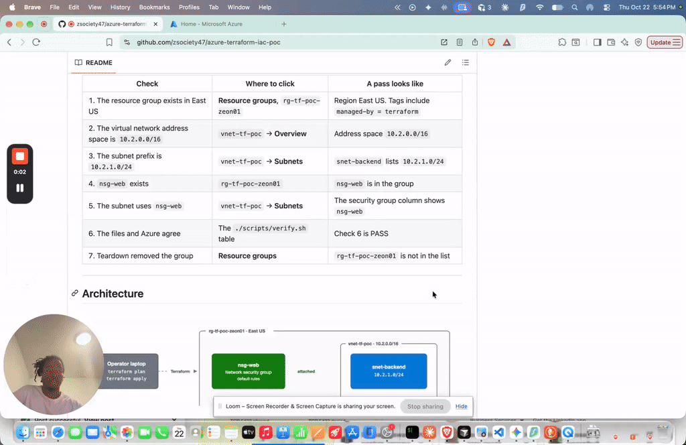](https://www.loom.com/share/b0448fef104a4bdc90a3d7c63cad2014)

**Author:** Zeon Stewart, [LinkedIn](LINKEDIN_LINK_HERE)

## At a glance

- **What it is:** a virtual network on Microsoft Azure, described in text files. Terraform creates it, adds a firewall later without rebuilding it, and removes it with one command.
- **What's automated:** `terraform plan` shows the change before anything is created. `terraform apply` builds it. `./scripts/verify.sh` checks the result. `terraform destroy` deletes it.
- **Why it's secure:** the network security group is attached to the subnet and has no custom allow rule. The state file, which holds resource identifiers, stays off GitHub. The subscription id is not in these files.
- **Result:** all six verify checks passed while the network was up. `terraform destroy` then removed the resource group. The screenshots are in the steps below.

Part of [Cloud Projects](https://github.com/zsociety47/cloud-projects). Technical details are in [Technical findings](#technical-findings) at the bottom.

---

## Project Steps

These steps follow the files in the order each one needs the one before it. A reference such as `azurerm_resource_group.rg.name` is both a value and a dependency: Terraform waits for that resource group before it creates the virtual network.

The firewall is two files, `nsg.tf` and `nsg_association.tf`, so it can be added after the network already exists. Move them aside before the first plan. Terraform only reads files whose names end in `.tf`. Apply the network, put the two files back, and the second plan adds the firewall without changing the network.

```bash
mkdir -p /tmp/tf-later
mv nsg.tf nsg_association.tf /tmp/tf-later/
```

Have Terraform 1.15 and the Azure command-line interface (CLI) installed, and sign in with `az login` before the first plan. Set the subscription for the terminal session without writing it into a file:

```bash
export ARM_SUBSCRIPTION_ID="$(az account show --query id -o tsv)"
```

`ARM` is the prefix the Azure Resource Manager (AzureRM) provider uses for its environment variables. Read each plan before you type `yes`.

### Step 1: Keep the state file off GitHub

*Declared in `.gitignore`, before `terraform init` or `terraform apply`.*

`terraform init` downloads the provider into `.terraform/`. `terraform apply` writes `terraform.tfstate`, Terraform's record of resource identifiers. Both are ignored. `.terraform.lock.hcl` is not ignored. It pins the provider build so the next run uses the same one.

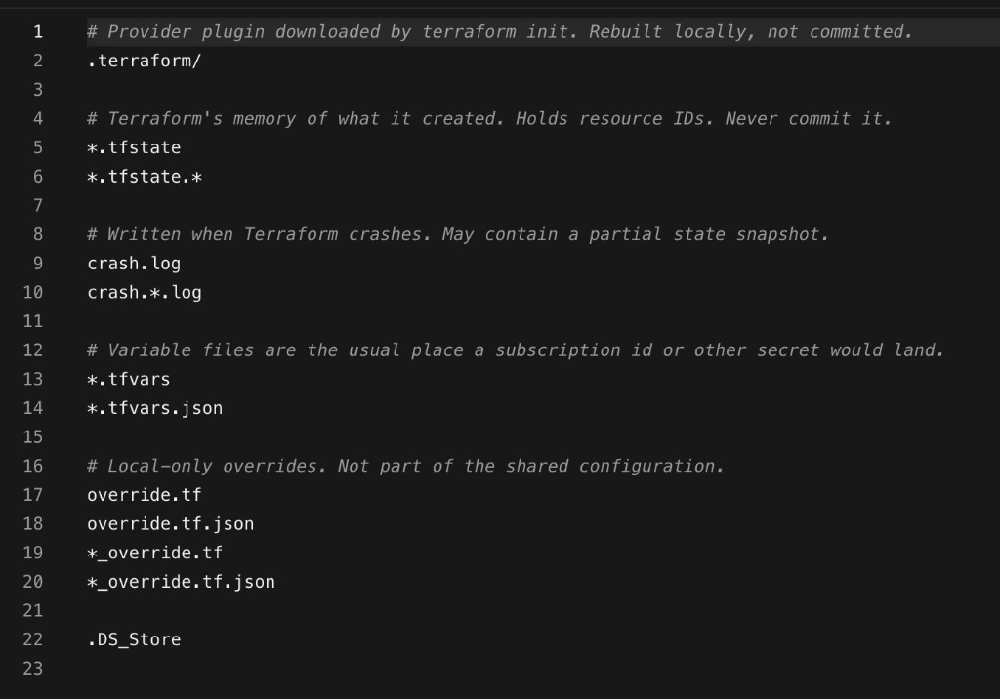

### Step 2: Pin the provider

*Declared in `versions.tf`. Read by `terraform init`.*

The Terraform block requires version 1.15.x and the AzureRM provider `5.9.0` exactly. `terraform init` downloads that provider. Later resource files depend on this pin.

```bash
terraform init
```

The last line should be `Terraform has been successfully initialized!`

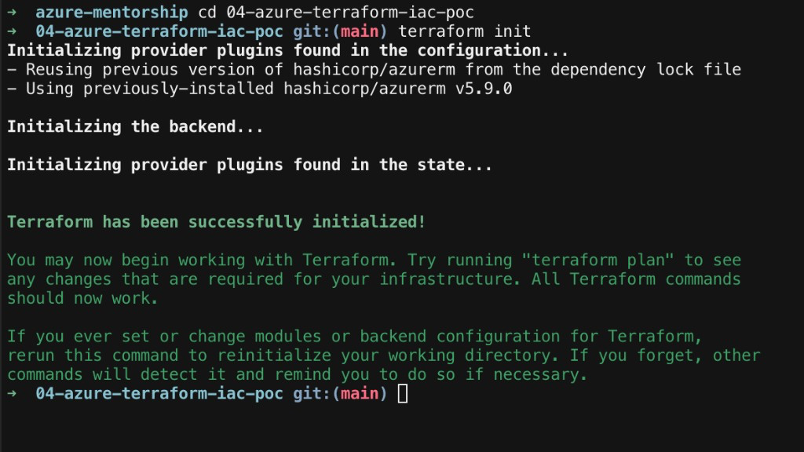

### Step 3: Sign in without storing the subscription id

*Declared in `provider.tf`. Used by every later file.*

The provider uses the Azure CLI login already on the machine. There is no `subscription_id` line in the file. The value comes from `ARM_SUBSCRIPTION_ID`. `features {}` is required even when empty. `resource_provider_registrations = "none"` means apply does not register Azure resource providers. `Microsoft.Network` is already registered on a subscription that has created a virtual network before.

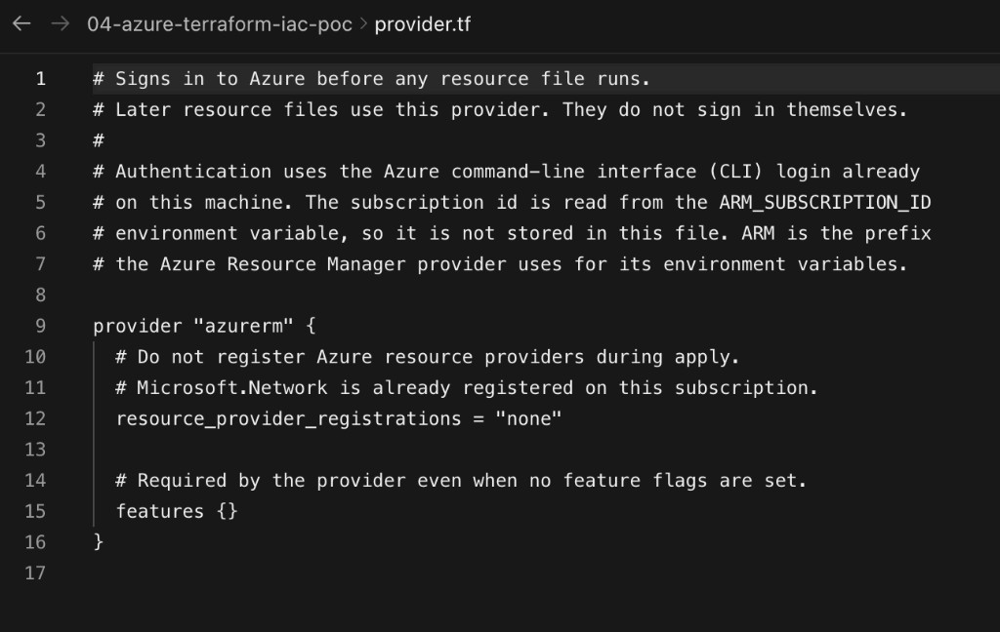

### Step 4: Put the names in one place

*Declared in `variables.tf`. Read by every resource file.*

| Name | Value |
|---|---|
| Resource group | `rg-tf-poc-zeon01` |
| Virtual network | `vnet-tf-poc` |
| Subnet | `snet-backend` |
| Network security group | `nsg-web` |
| Region | East US |
| Virtual network address space | `10.2.0.0/16` |
| Subnet prefix | `10.2.1.0/24` |

Tags on the resource group, the virtual network, and the network security group: `project = azure-terraform-iac-poc`, `environment = poc`, `managed-by = terraform`, `owner = zeon`.

The address space `10.2.0.0/16` can exist beside other networks that use `10.0.0.0/16` and `10.1.0.0/16`.

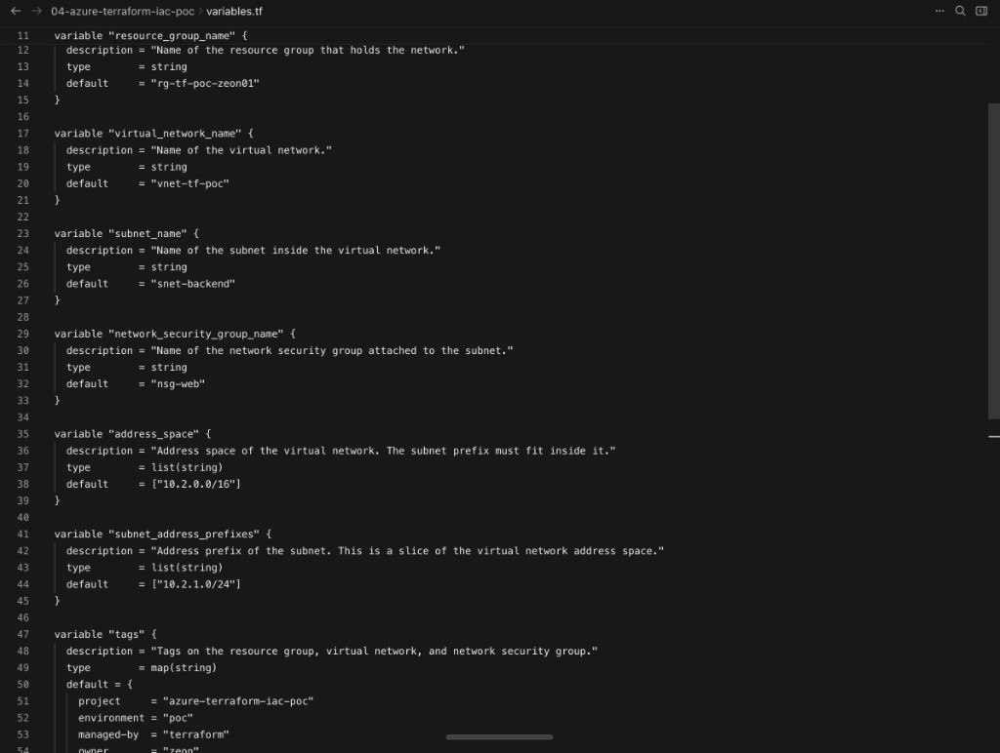

### Step 5: Create the resource group

*Declared in `resource_group.tf`. Created by `terraform apply`.*

Every resource in this build lives in this group. The virtual network file points at `azurerm_resource_group.rg`, so the group is declared first. The group name is `rg-tf-poc-zeon01`. The first plan is in step 7, after the subnet file, while the firewall files are still set aside.

### Step 6: Create the virtual network

*Declared in `vnet.tf`. Created by `terraform apply`.*

`location` and `resource_group_name` come from the resource group, so Terraform will not create the network until the group exists. The address space is `10.2.0.0/16`.

### Step 7: Cut the subnet

*Declared in `subnet.tf`. Created by `terraform apply`.*

`snet-backend` uses `10.2.1.0/24`, a slice of `10.2.0.0/16`. `virtual_network_name` points at `azurerm_virtual_network.vnet`, so the network has to exist first. This file does not mention the network security group.

With the firewall files still set aside, plan and apply. The plan is `3 to add, 0 to change, 0 to destroy`: the resource group, `vnet-tf-poc`, and `snet-backend`. Type the full word `yes`.

```bash
terraform plan
terraform apply
```

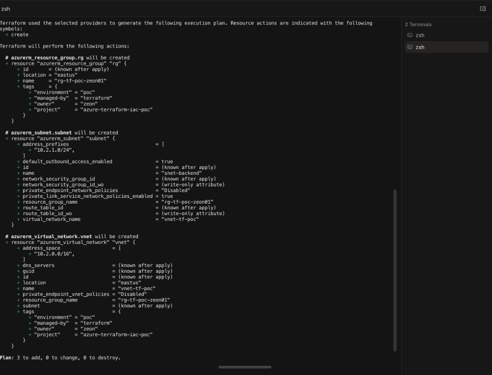

### Step 8: Add the firewall to the live network

*Declared in `nsg.tf`. Created by `terraform apply`.*

A network security group (NSG) is the subnet firewall. `nsg-web` needs only the resource group. It is a separate file so it can be added after the subnet is already running. There is no custom rule in this file. This file does not attach the group to the subnet. That is the next file.

### Step 9: Attach the firewall to the subnet

*Declared in `nsg_association.tf`. Created by `terraform apply`.*

The association names `azurerm_subnet.subnet.id` and `azurerm_network_security_group.nsg.id`. Both sides have to exist first. Put the two firewall files back. Both were moved together, so both come back before this plan.

```bash
mv /tmp/tf-later/nsg.tf /tmp/tf-later/nsg_association.tf .
terraform plan
terraform apply
```

The plan is `2 to add, 0 to change, 0 to destroy`. The two new resources are `nsg-web` and the association. The `0 to change` means the resource group, `vnet-tf-poc`, and `snet-backend` already match the files, so Terraform leaves them alone. Type the full word `yes`. After this apply, Azure's default rules apply to `snet-backend`: traffic from inside the virtual network is allowed, and other inbound traffic is denied.

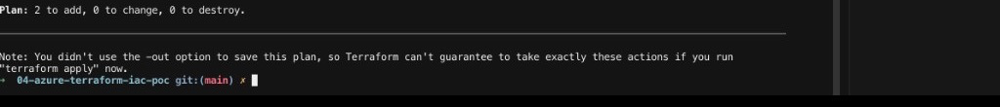

In the portal, open `rg-tf-poc-zeon01`, then `vnet-tf-poc`, then **Subnets**. `snet-backend` shows prefix `10.2.1.0/24` and network security group `nsg-web`.

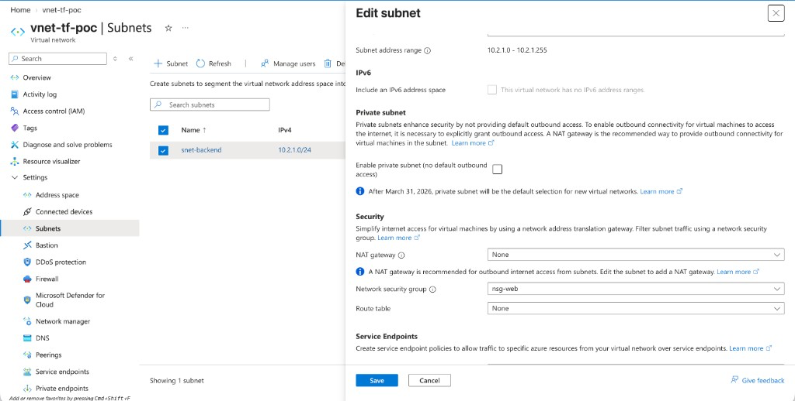

### Step 10: Check the live network

*Run `./scripts/verify.sh`.*

The script reads Azure and prints six lines. It does not create or delete anything. Check 6 passes only when `terraform plan` reports no changes, which means the files and Azure agree.

```bash
./scripts/verify.sh
```

A passing run looks like this:

```text
1  Resource group rg-tf-poc-zeon01 is in eastus: PASS
2  Virtual network vnet-tf-poc address space is 10.2.0.0/16: PASS
3  Subnet snet-backend prefix is 10.2.1.0/24: PASS
4  Network security group nsg-web exists: PASS
5  Subnet snet-backend uses nsg-web: PASS
6  terraform plan reports no changes: PASS
```

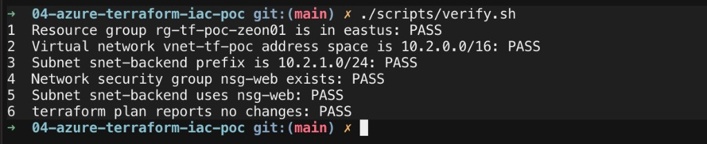

### Step 11: Remove it

*`terraform destroy`, after you read the plan and type `yes`.*

Destroy reads the state file and removes what it lists. The order follows the references in reverse: the association, then the network security group and the subnet, then the virtual network, then the resource group.

```bash
terraform destroy
```

The plan should be `0 to add, 0 to change, 5 to destroy`. When it finishes, `rg-tf-poc-zeon01` is gone. The state file is updated, so the next plan does not look for resources that were deleted by hand in the portal. Run `./scripts/verify.sh` once more and all six lines print `FAIL`. That is the expected result. There is nothing left for the checks to find.

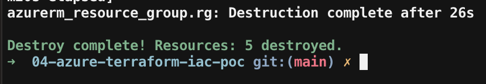

---

## Automated setup

### Run this as yourself

The names committed in this repository are this proof of concept. Leave [`variables.tf`](variables.tf). Put your owner word in the copy you run. The sequence is the same as the [naming standard](https://github.com/zsociety47/cloud-projects/blob/main/standards/NAMING-STANDARD.md): type, project, environment, then **your** owner word and number (`rg-tf-poc-zeon01` becomes `rg-tf-poc-ada01`).

| Open this | Do this |
|---|---|
| [`terraform.tfvars.example`](terraform.tfvars.example) | Copy to `terraform.tfvars` (gitignored). Change `resource_group_name` and `tags.owner`. Put your owner word in the resource group name. Leave `vnet-tf-poc` and `snet-backend`; they only have to be unique in your group. |
| [`variables.tf`](variables.tf) | Read only. These defaults are this proof. |

```bash
cp terraform.tfvars.example terraform.tfvars
```

You need Terraform 1.15.x, the Azure CLI, and a current `az login`. From the repository root:

```bash
export ARM_SUBSCRIPTION_ID="$(az account show --query id -o tsv)"
terraform init
mkdir -p /tmp/tf-later
mv nsg.tf nsg_association.tf /tmp/tf-later/
terraform plan
terraform apply
mv /tmp/tf-later/nsg.tf /tmp/tf-later/nsg_association.tf .
terraform plan
terraform apply
./scripts/verify.sh
terraform destroy
```

`terraform init` is once per machine. It covers step 2. The first `terraform plan` is step 7: `3 to add, 0 to change, 0 to destroy`, the resource group, `vnet-tf-poc`, and `snet-backend`. The second `terraform plan` is step 9: `2 to add, 0 to change, 0 to destroy`, `nsg-web` and the association. Type `yes` only after you have read each plan. `./scripts/verify.sh` is step 10. `terraform destroy` is step 11, and it asks for `yes` on its own. After the second `mv`, the folder matches this repository again.

If Microsoft Entra ID asks for multi-factor authentication, approve it in the browser. Do not add `--use-device-code` to `az login`. That flow is often blocked when the computer is not registered with Entra ID.

### Prove it in the portal

| Check | Where to click | A pass looks like |
|---|---|---|
| 1. The resource group exists in East US | **Resource groups**, `rg-tf-poc-zeon01` | Region East US. Tags include `managed-by = terraform` |
| 2. The virtual network address space is `10.2.0.0/16` | `vnet-tf-poc` → **Overview** | Address space `10.2.0.0/16` |
| 3. The subnet prefix is `10.2.1.0/24` | `vnet-tf-poc` → **Subnets** | `snet-backend` lists `10.2.1.0/24` |
| 4. `nsg-web` exists | `rg-tf-poc-zeon01` | `nsg-web` is in the group |
| 5. The subnet uses `nsg-web` | `vnet-tf-poc` → **Subnets** | The security group column shows `nsg-web` |
| 6. The files and Azure agree | The `./scripts/verify.sh` table | Check 6 is PASS |
| 7. Teardown removed the group | **Resource groups** | `rg-tf-poc-zeon01` is not in the list |

---

## Architecture

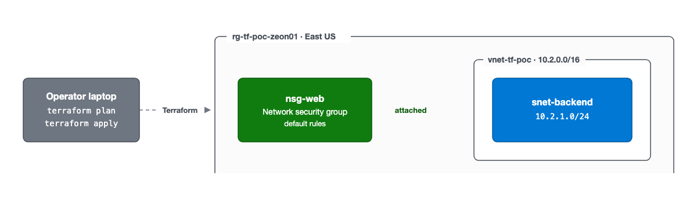

**How to read this diagram**

- **Solid arrow:** the network security group is attached to `snet-backend`. There is no virtual machine, so there is no application request on this diagram.
- **Dashed arrow:** Terraform creates, updates, and destroys the resource group from the laptop.
- **Blue:** the subnet inside the virtual network. **Green:** the firewall. **Gray:** the laptop running Terraform.

*The text files are the source of truth. Terraform changes only the piece that differs from the state file.*

*Diagram follows the [shared diagram standard](https://github.com/zsociety47/cloud-projects/blob/main/standards/DIAGRAM-STANDARD.md).*

---

## Hypothesis

A Terraform configuration can create a resource group and a virtual network, then add a network security group to the subnet that already exists, changing only the new objects, and `terraform destroy` can remove all of them while keeping the state file in agreement with Azure.

## Success criteria

| # | Criterion | How it is checked | Result |
|---|-----------|-------------------|--------|
| 1 | `rg-tf-poc-zeon01` exists in East US | `./scripts/verify.sh` check 1 | ✅ [verify](docs/images/step-10-verify.png) |
| 2 | `vnet-tf-poc` address space is `10.2.0.0/16` | `./scripts/verify.sh` check 2 | ✅ [verify](docs/images/step-10-verify.png) |
| 3 | `snet-backend` prefix is `10.2.1.0/24` | `./scripts/verify.sh` check 3 | ✅ [verify](docs/images/step-10-verify.png) |
| 4 | `nsg-web` exists | `./scripts/verify.sh` check 4 | ✅ [verify](docs/images/step-10-verify.png) |
| 5 | `snet-backend` uses `nsg-web` | `./scripts/verify.sh` check 5 | ✅ [verify](docs/images/step-10-verify.png) |
| 6 | After apply, `terraform plan` reports no changes | `./scripts/verify.sh` check 6 | ✅ [verify](docs/images/step-10-verify.png) |
| 7 | `terraform destroy` removes the resource group | `az group exists --name rg-tf-poc-zeon01` is false | ✅ [destroy](docs/images/step-11-destroy.png) |

## What's in this repository

```
.
├── versions.tf              Terraform 1.15 and AzureRM provider 5.9.0
├── provider.tf              Azure CLI sign-in. No subscription id in the file
├── variables.tf             Names, region, address space, and tags
├── resource_group.tf        rg-tf-poc-zeon01
├── vnet.tf                  vnet-tf-poc, 10.2.0.0/16
├── subnet.tf                snet-backend, 10.2.1.0/24
├── nsg.tf                   nsg-web, no custom rules
├── nsg_association.tf       Attaches nsg-web to snet-backend
├── scripts/
│   └── verify.sh            Pass/fail checks against the live network
├── .terraform.lock.hcl      Exact provider build selected by terraform init
└── docs/
    ├── architecture/        The architecture picture
    └── images/              Screenshots for the steps above
```

## Security choices

- **The state file stays on the machine.** `terraform.tfstate` holds resource identifiers, including the subscription id. `.gitignore` excludes it. Do not delete it by hand while the resources exist. `terraform destroy` updates it.
- **The subscription id is an environment variable.** `provider.tf` does not contain it. `*.tfvars` files are ignored so a later variable file cannot sneak it into a commit.
- **The firewall is attached, and it allows no custom inbound traffic.** `nsg-web` has no `security_rule` block. Once `nsg_association.tf` is applied, Azure's default rules are in force on `snet-backend`: virtual-network traffic is allowed, and other inbound traffic is denied.
- **There is no virtual machine and no public Internet Protocol address.** Nothing in this network is listening. The network security group is in place for the next resource that joins the subnet.
- **Apply does not register resource providers.** `resource_provider_registrations = "none"`. The subscription must already have `Microsoft.Network` registered.

## Cost

A resource group, a virtual network, a subnet, and a network security group have no hourly charge. This build has no virtual machine and no public Internet Protocol address, which are the pieces that cost money in the other networks. Delete the group when you are done so the state file and the subscription stay in agreement. Prices were checked in October 2026.

## Going further

- Add a virtual machine on `snet-backend` and one inbound rule that allows Secure Shell (port 22) from the operator's address only.
- Turn off default outbound access on the subnet when the machines in it should not reach the internet directly.
- Store `terraform.tfstate` in a remote backend so the memory of the network is not only on one laptop.
- Add a custom rule only when there is a workload to protect. An empty group plus the association is the firewall this network needs today.

---

## Technical findings

*For engineers: what actually happened while building this, including the errors.*

- **`East US` is stored as `eastus`.** `variables.tf` sets `location = "East US"`. The plan shows `location = "eastus"`. Those are the same region. The provider stores Azure's region code. Verify check 1 compares against `eastus`.
- **The provider fills in defaults that are not in the files.** A new virtual network plans `private_endpoint_vnet_policies = "Disabled"`. A new subnet plans `default_outbound_access_enabled = true`, `private_endpoint_network_policies = "Disabled"`, and `private_link_service_network_policies_enabled = true`. Leaving them unset keeps the provider's defaults. Setting them in the files would make the next plan show those choices as written configuration.
- **A plan prints full resource identifiers.** The association plan shows the subnet id and the network security group id. Those strings contain the subscription id, so they are not pasted into this README. Verify keeps only the last segment of the security group id when it checks that `snet-backend` uses `nsg-web`.
- **An empty network security group still has Azure's default rules.** The first plan of `nsg.tf` shows `security_rule` as known after apply, because the file declares no custom rules. After create, the custom rule list is empty. The default rules are not custom rules, and they apply to the subnet only after the association exists.
- **Destroy follows the references backward.** The association was removed first, then the network security group and the subnet, then the virtual network, then the resource group. The resource group delete took 26 seconds after the network was already gone. Deleting the group in the portal instead would leave `terraform.tfstate` pointing at resources that no longer exist, and the next plan would fail looking for them.
- **AzureRM provider 5.9.0 requires the subscription id.** It can be set in the provider block or in `ARM_SUBSCRIPTION_ID`. This repository uses the environment variable. Provider 5 also defaults `resource_provider_registrations` to `none`. The explicit setting in `provider.tf` records that choice.
